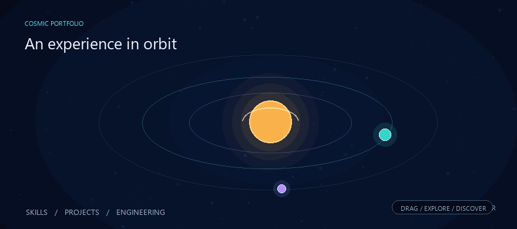
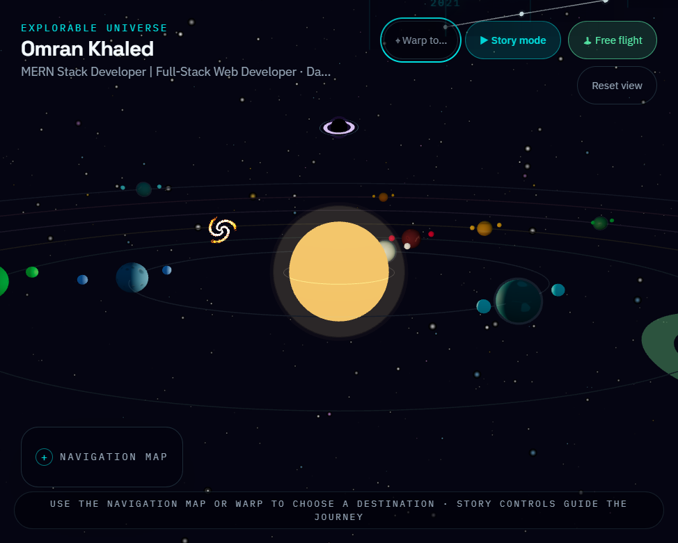
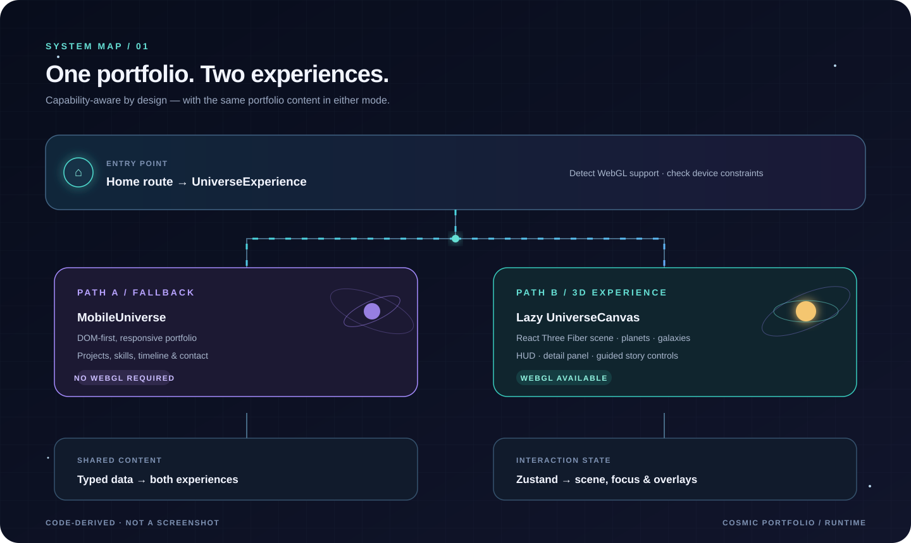
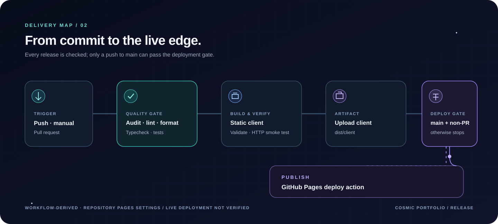

# Cosmic Portfolio

> Personal portfolio experience for Omran Khaled

An explorable 3D portfolio experience implemented as a static React + Vite app. The repository is the source of truth: the code and build scripts define the actual behavior, while the docs explain it.

## A universe you can actually see

<p align="center">
  
</p>

The looping illustration sets the scene; the image below is a real capture of the running portfolio.

<p align="center">
  
</p>

<p align="center"><sub>Live interface · captured locally from the running application</sub></p>

---

## Documentation map

- [CONTRIBUTING.md](CONTRIBUTING.md) — owner-approved contribution workflow
- [OWNERSHIP.md](OWNERSHIP.md) — ownership terms

## Overview

Cosmic Portfolio is a single-page portfolio experience built with React, TypeScript, Tailwind CSS, and Three.js. It presents professional identity, skills, projects, and contact information as an interactive universe: skill planets, project galaxies, and an AI/engineering focus node are arranged within a navigable 3D scene.

The real user flow is implemented in code rather than in prose. The app performs WebGL capability detection, falls back to a 2D experience on constrained devices, and keeps a static GitHub Pages deployment path aligned with the configured base URL.

---

## Core features

### 🪐 Interactive universe

- Three.js + React Three Fiber scene with orbital framing and focus transitions
- Data-driven planets, galaxies, and timeline content from `src/data/`
- Story mode, orbit navigation, and camera focus transitions driven by a Zustand store

### 📱 Resilient delivery

- Mobile/low-capability fallback via WebGL detection and `shouldUseMobileUniverse()`
- Static build output for GitHub Pages, with a release validator and base-aware preview
- Lazy loading for the 3D layer and optional media surfaces

### ♿ Interaction and fallback behavior

- Modal surfaces use the shared focus-management hook; the destination detail panel is non-modal
- Reduced-motion preferences affect scene animation and automatic camera movement
- The app switches to a DOM-first 2D portfolio when device/browser checks select the fallback

No WCAG, Lighthouse, frame-rate, or load-time score is claimed here: no such audit or measurement was run for this documentation update.

## Runtime and data flow



**Sources:** [home route](src/routes/index.tsx), [experience selector](src/features/universe/UniverseExperience.tsx), [3D scene](src/components/universe/UniverseCanvas.tsx), [mobile view](src/components/overlay/MobileUniverse.tsx), [universe store](src/hooks/useUniverse.tsx), [portfolio data](src/data/index.ts).

## Release workflow



**Sources:** [Pages workflow](.github/workflows/deploy.yml), [package scripts](package.json), [Vite base configuration](vite.config.ts). The workflow is configured for Pages deployment; this does not verify repository Pages settings or a live deployment.

---

## Technology Stack

| Layer          | Technology                       | Purpose                                                                                 |
| -------------- | -------------------------------- | --------------------------------------------------------------------------------------- |
| **Framework**  | React 19 + TypeScript 5.8        | Type-safe UI with strict mode                                                           |
| **3D Engine**  | Three.js 0.185 + R3F + Drei      | Declarative 3D scene management                                                         |
| **Styling**    | Tailwind CSS 4.2 + Framer Motion | Utility-first styling + animations                                                      |
| **Routing**    | TanStack Router + Start          | Root and home routes with a static SPA shell                                            |
| **State**      | Zustand + TanStack Query         | Universe interaction store; a QueryClient provider is wired, but no query use was found |
| **Build**      | Vite ^8.3.4                      | Build tool with configured vendor chunk groups                                          |
| **Validation** | Zod                              | Data schemas used by explicit validation tests; not imported by the app entry           |

---

## Quick Start

### Prerequisites

- **Node.js** >= 22.12.0
- **pnpm** 10.34.5 (pinned in `package.json`; use `corepack pnpm`)

### Installation

```bash
# Clone the repository
git clone https://github.com/Omran-Khaled/cosmic-portfolio.git
cd cosmic-portfolio

# Install dependencies
pnpm install

# Start development server
pnpm dev
```

Visit `http://localhost:5173` to explore the universe.

---

## Development Scripts

| Command                 | Action                                                      |
| ----------------------- | ----------------------------------------------------------- |
| `pnpm dev`              | Start development server with HMR                           |
| `pnpm build`            | Production build with optimizations                         |
| `pnpm build:dev`        | Vite development-mode build                                 |
| `pnpm preview`          | Preview the built static client at its configured base path |
| `pnpm preview:static`   | Alias for the base-path-aware static preview                |
| `pnpm smoke:static`     | Smoke-test built routes and asset status/content types      |
| `pnpm typecheck`        | Run strict TypeScript checks                                |
| `pnpm lint`             | Run ESLint with TypeScript rules                            |
| `pnpm format:check`     | Check Prettier formatting without changing files            |
| `pnpm test`             | Run deterministic Node test-runner tests                    |
| `pnpm release:validate` | Validate the emitted client artifact before release         |
| `pnpm start`            | Start the base-path-aware static preview                    |

## GitHub Pages deployment

The workflow is configured to build the static client on pushes to `main`,
manual runs, and pull requests. Its deploy job is gated to non-PR runs on
`main` and publishes `dist/client` with the GitHub Pages action. The Vite
production base defaults to `/cosmic-portfolio/`; GitHub Pages serves the
static client artifact, so `src/server.ts` is not required at runtime.
Repository Pages settings, deployment permissions, and the live site were not
verified in this environment.

To verify the release artifact locally:

```bash
pnpm install --frozen-lockfile
pnpm typecheck
pnpm lint
pnpm format:check
pnpm test
pnpm build
pnpm release:validate
pnpm smoke:static
pnpm preview
```

The production build explicitly runs `scripts/postbuild.mjs`; it does not rely on
package-manager-specific implicit `postbuild` lifecycle behavior. The intended
static upload is `dist/client` only, never `dist/server`. Use Node.js `>=22.12.0`
and the packageManager-pinned pnpm `10.34.5` (run `corepack pnpm` to use the
pinned version).

The production Vite base is `/cosmic-portfolio/`; set `VITE_BASE=/` only when
intentionally building a root-hosted copy. GitHub Pages serves the static client,
so server response headers in `src/server.ts` do not protect that deployment. The
built `index.html` receives a meta CSP (which cannot enforce `frame-ancestors`);
the static artifact does not provide HTTP security headers.

Owner-supplied media must be placed under `public/` before building:

- `public/favicon.svg` — required favicon.
- `public/cv/omran_khaled.pdf` — optional CV. The UI checks availability and
  reports when the PDF is not included; it is not fabricated by the build.
- `public/khuta.mp4`, `public/wandr.mp4`, `public/library.mp4`,
  `public/Nexara.mp4`, and `public/Finora.mp4` — optional demos. A missing video
  has an in-product error/retry state. Release validation warns, rather than fails,
  when these owner-supplied files are absent from a source archive.

The workflow runs dependency audit, lint, format check, typecheck, tests, build,
release validation, and the static HTTP smoke test before uploading
`dist/client`. These checks validate the generated artifact; they do not prove a
successful live deployment.

---

## Project Structure

```
src/
├── client.tsx            # Browser entry
├── routes/               # Root layout and home route
├── features/universe/    # Experience mode selection and composition
├── components/           # 3D scene and DOM overlays
│   ├── celestial/        # 3D objects (planets, galaxies, black hole)
│   ├── overlay/          # UI panels, HUD, modals, mobile fallback
│   ├── shared/           # Primitive components
│   └── universe/         # 3D scene infrastructure
├── data/                 # Typed portfolio content and validation schemas
├── hooks/                # Universe state and interaction hooks
├── lib/                  # Camera, WebGL, layout, and disposal utilities
├── router.tsx            # TanStack Router setup
└── start.ts              # TanStack Start entry
```

```text
Repository root
├── scripts/              # Build and static-release validation tools
└── assets/               # README visuals: animated illustration, app capture, and diagrams
```

---

## Key Technical Decisions

| Decision                       | Rationale                                    |
| ------------------------------ | -------------------------------------------- |
| **Data-driven content**        | Update portfolio without touching components |
| **Zustand for universe state** | Shared focus, story, and interaction state   |
| **Manual chunking**            | Separate configured vendor groups            |
| **Adaptive DPR**               | Adapt rendering quality to device capacity   |
| **Zod schemas**                | Explicit data validation is covered by tests |

---

## Performance and verification

The scene uses device-informed quality tiers, a `PerformanceMonitor`, reduced-motion handling, and lazy loading. These are implementation details, not a measured performance guarantee. The latest local build emitted Vite's configured large-chunk warning for the Three.js vendor bundle. No browser performance benchmark is currently published.

---

## Contributing

This is a personal portfolio project by **Omran Khaled**. Contributions, issues, and feedback require owner approval.

See [CONTRIBUTING.md](CONTRIBUTING.md) for development guidelines.

---

## License

Copyright © 2026 **Omran Khaled**. All rights reserved.

See [OWNERSHIP.md](OWNERSHIP.md) for complete intellectual property terms.

---

## Connect

- **GitHub**: [@Omran-Khaled](https://github.com/Omran-Khaled)
- **LinkedIn**: [in/omran-khaled](https://www.linkedin.com/in/omran-khaled-334726426)
- **Email**: omranhk815@gmail.com

---

_Built with discipline. Shipped with intent._
